# WeatherWindow — comprendre et expliquer tout le code

But : pouvoir expliquer chaque fichier en 30 secondes et répondre aux questions de Jason après la démo.
Les schémas sont en Mermaid : ils s'affichent sur GitHub, sur GitLab et dans l'aperçu Markdown de VS Code.
Les phrases en *italique anglais* sont prêtes à dire à l'oral.

---

## 1. Ce qui a changé le 12 octobre (simplification)

Ce tableau garde les noms de l'époque. Depuis le 16 octobre, beaucoup ont changé : voir §1 ter.

Rien n'a été ajouté ni retiré côté fonctions : même écrans, même solveur, même nowcast. Seule la façon d'écrire a changé.

| Avant | Maintenant | Pourquoi c'est plus simple |
| --- | --- | --- |
| `PlanServices` : une struct de 6 closures + 3 fabriques (`live`, `replay`, `current`) | Un protocole `PlanDataSource` et trois structs : `LiveData`, `ReplayData`, `FakeData` (tests) | Un protocole avec des implémentations, c'est le même principe que `RainField` |
| `AppMode`, `ReplaySession`, `AppResources`, `SettingsKey` | `ReplayData` (heure figée + fichiers enregistrés) et `@AppStorage("replayMode")` | Moins de « namespaces » vides |
| `DirectionsService` + `WalkingMatrixBuilder` + `RouteService`, avec `TaskGroup`, 3 requêtes en parallèle, 2 reprises | Un seul `DirectionsService`, une requête à la fois, une reprise après 3 s | 20 requêtes, c'est peu : la boucle simple suffit |
| `LocationService` avec `CLServiceSession`, `liveUpdates` et une course contre un timeout | Le `LocationProvider` du **lab 7** (délégué + timeout 15 s) transformé en `async` | Motif vu en cours |
| `LiveRainViewerSource` : actor singleton, cache, téléchargements en parallèle | Actor simple : une boucle sur 4 tuiles | Rafraîchi toutes les 10 min, le cache ne servait presque à rien |
| Bandeau de rejeu ajouté sur 7 écrans par un `ViewModifier` | Une fois, au-dessus du `TabView` dans `RootView` | |
| `NavigationPath` + enum `PlanRoute` | `NavigationLink { … }` et `.navigationDestination(isPresented:)` | Comme dans les labs |
| Graphe : `chartOverlay` + `GeometryReader` + distance 2D | `chartXSelection` + plan à la durée la plus proche | API Apple prévue pour ça |
| Collision view : fabrication d'un `CGImage` octet par octet | Le `Canvas` dessine un carré de couleur par pixel radar | |
| Package : génériques, dichotomie, `zip`, fonctions imbriquées, `DateProvider` | Boucles `for`, `first(where:)`, fonctions privées, `PlanRequest.neededPairs`, `Node.location` | Lisible ; `ww verify` donne **exactement** les mêmes scores qu'avant |

Bugs corrigés au passage :

1. Les tests écrivaient dans les vrais réglages de l'app (`UserDefaults`) ; maintenant chaque test a ses réglages vides.
2. La carte pouvait afficher le tracé d'un autre plan après un nouveau choix sur le graphe.
3. Le nowcast pouvait planter si un lieu était hors de la tuile radar de Melbourne : nouveau cas `outsideRadar`.
4. La fenêtre de départ pouvait déjà être passée si l'app restait ouverte.

---

## 1 bis. Ce qui a été ajouté le 14 octobre (Mac 2)

Le MVP a été vérifié dans le simulateur (tag `mvp`), puis la branche `bonus` a été fusionnée et testée sur le Mac.

| Fonction | Où la voir | Fichiers | À dire en une phrase |
| --- | --- | --- | --- |
| Modifier une course | Errands ▸ toucher une course | `ErrandFormModel(errand:)`, `ErrandStore.update`, `ErrandListView` | « Le même formulaire, déjà rempli ; le plan enregistré garde sa copie. » |
| Précision du nowcast | About ▸ *How Accurate Is the Nowcast?* | `Screens/About/Verification*`, `Database/VerificationScore` | « Je rejoue la journée de pluie et je compare au radar réel : le nowcast bat la persistance, et les scores restent dans SwiftData. » |
| Prévision d'ensemble | About ▸ *Use the 40-run ensemble forecast* | `Rain/Ensemble`, `DayPlanViewModel.calculate` | « Les décalages couvrent une pluie en avance ou en retard ; l'ensemble couvre "va-t-il pleuvoir du tout". Le solveur n'a pas changé. » |
| Ton choix habituel | Results, après 2 plans enregistrés | `DayPlan.tradeOff`, `PlanResult.usualChoice` | « Je retiens où se trouvait chaque plan enregistré entre rapide (0) et sec (1), et je propose la moyenne. » |
| Partager un plan | Itinerary ▸ bouton Partager | `PlanResult.shareText`, `ShareLink` | « Le plan en texte simple, pour la feuille de partage d'iOS. » |
| Alerte pluie | Next Walk ▸ *Alert Me If Rain Is Coming* | `NextWalkViewModel.rainAlert`, `NotificationService.alertNow` | « Une seule alerte quand le prochain trajet devient pluvieux, tant que l'écran est ouvert. » |
| Carte radar | Next Walk ▸ *Map / Radar Grid* | `RadarMapView`, `PixelConverter.point(forPixelX:y:)` | « Les pixels de pluie voisins de même niveau deviennent un `MapPolygon` sur la carte Apple. » |
| Course décrite en une phrase | Errands ▸ + ▸ *Describe It* (iOS 26 + Apple Intelligence) | `Services/ErrandAssistant`, `ErrandFormModel.fill` | « Foundation Models lit la phrase sur l'iPhone et remplit le formulaire ; sans Apple Intelligence, la section n'apparaît pas. » |

Bugs corrigés : une course supprimée gardait une des 4 places dans Plan (`keepSelected(onlyAmong:)`), et rouvrir un itinéraire permettait d'enregistrer le même plan deux fois (`PlanResult.isSaved`).

---

## 1 ter. Ce qui a changé le 16 octobre : tout dans l'app, des noms simples

Rien n'a été ajouté ni retiré côté fonctions : mêmes écrans, même solveur, même nowcast, mêmes tests (avec les mêmes noms). Trois choses changent :

- **où sont les fichiers** : plus de package, tout est dans l'app ;
- **le nom des types** : des mots simples à la place du jargon ;
- **les commentaires** : il n'y en a plus aucun dans le code, seulement l'en-tête Xcode, comme dans les labs. Les explications qui étaient en commentaire sont maintenant ici, au §12.

### Où chercher quoi

| Je cherche… | Dossier |
| --- | --- |
| Un écran | `Screens/<onglet>/` : la vue et son view model côte à côte |
| Ce qui est enregistré sur le téléphone | `Database/` (SwiftData) |
| Ce qui parle à Internet, au GPS, à Apple Maps, aux notifications | `Services/` |
| L'algorithme qui choisit l'ordre et l'heure de départ | `Planner/` |
| « Combien de pluie ici, à cette minute ? » | `Rain/` |
| Le radar et le nowcast | `Radar/` |
| Les petits outils partagés | `Helpers/` |

### Anciens noms → nouveaux noms

| Avant | Maintenant | Le mot à dire à l'oral |
| --- | --- | --- |
| `ScheduleSolver` (`SolverKit/`) | `Planner` (`Planner/Planner.swift`) | solveur |
| `ScoredSchedule` | `Schedule` (`Planner/Schedule.swift`) | un plan possible |
| `Leg` | `Walk` (même fichier) | un trajet à pied |
| `Node` | `Waypoint` (`Planner/Stop.swift`) | le départ, l'arrivée ou une course |
| `LegSample`, `LegSampler` | `WalkMinute`, `WalkRain` (`Planner/WalkRain.swift`) | une minute de trajet ; la pluie d'un trajet |
| `SolveOutcome` `.frontier` / `.infeasible` | `PlanOutcome` `.schedules` / `.noPlan` (`Planner/PlanOutcome.swift`) | |
| `InfeasibilityReason` | `NoPlanReason` (même fichier) | |
| `ParetoFrontier.frontier(of:)` | `TradeOffs.best(of:)` (`Planner/TradeOffs.swift`) | front de Pareto |
| `RainField` (`WeatherWindowCore/`) | `RainForecast` (`Rain/RainForecast.swift`) | |
| `HourlyRainField`, `ShiftedRainField` | `HourlyForecast`, `ShiftedForecast` (`Rain/`) | scénarios de robustesse |
| `NowcastRainField` | `RadarForecast` (`Radar/`) | |
| `WeatherSample` + `RainWeight` | `ForecastHour` et sa propriété `rainWeight` (`Rain/ForecastHour.swift`) | |
| `OpenMeteoHourlyResponse`, `OpenMeteoRequest` | `OpenMeteoResponse` + `HourlyData`, et les URL dans `OpenMeteoService` (`Services/`) | |
| `OpenMeteoEnsembleResponse` | `EnsembleResponse` (le JSON) → `Ensemble` (`Rain/Ensemble.swift`) | prévision d'ensemble |
| `RainViewerMaps`, `LiveRainViewerSource` (actor) | `RainViewerResponse`, `RainViewerService` (`Services/RainViewerService.swift`) | |
| `Georeference` | `PixelConverter` (`Radar/`) | projection Mercator |
| `PixelRegion` | `PixelBox` (`Radar/RainGrid.swift`) | |
| `MotionVector`, `MotionField` | `Movement`, `RainMotion` (`Radar/RainMotion.swift`) | champ de mouvement |
| `BlockMatchingEstimator` | `MotionFinder` (`Radar/`) | block matching |
| `Advector` | `RainMover` (`Radar/`) | advection semi-lagrangienne |
| `NowcastEngine` | `NowcastMaker` (`Radar/NowcastMaker.swift`) | |
| `Verifier` | `NowcastScorer` (`Radar/`) | CSI, persistance |
| `RecordedFrameSource` | `RecordedRadar` (`Radar/`) | |
| `ReflectivityPalette` | `RadarColorTable` (`Radar/`) | palette Universal Blue |
| `ReflectivityConverter` (`rainRate`) | `RainRate` (`mmPerHour`) (`Radar/`) | Marshall–Palmer |
| `RadarColor` (couleurs à l'écran) | `RainColor` (`Screens/NextWalk/`) | |
| `RouteGeometry` | `RouteSplitter` (`Helpers/`) | |
| `GeoPoint` + `GeoPoint+CoreLocation` | `GeoPoint` (un seul fichier, `Helpers/`) | |
| `Features/…`, `Models/…`, `Shared/…` | `Screens/…`, `Database/…`, `Helpers/…` | |

### Ce qui a changé dans le code lui-même

1. **Plus de package.** Plus de `import SolverKit`, plus de `public`, plus d'`init` recopiés à la main : Swift les écrit tout seul (l'« init membre à membre »).
2. **`nonisolated`.** L'app est `@MainActor` par défaut (réglage Xcode 26). Les types de `Planner/`, `Rain/` et `Radar/` font du calcul pur, sans écran. Ils sont marqués `nonisolated` pour pouvoir tourner hors du thread principal. *"These types never touch the screen, so they are not tied to the main thread."*
3. **`@concurrent` sur le travail lourd.**
   - Comme avant : le solveur, le conseil radar et le score de précision.
   - En plus : `RecordedRadar.frames` et `RainViewerService.frames`, qui décodent les PNG.
   - Il n'y a plus d'`actor`.
4. **PNG sans bibliothèque C.** La décompression passe par `NSData.decompressed(using: .zlib)` (Foundation). Le `.zlib` d'Apple attend du DEFLATE « brut ». On enlève donc les 2 octets d'en-tête et les 4 octets de contrôle du flux zlib du PNG.
5. **JSON façon Lab 5.**
   - Des structs `Decodable` simples : `OpenMeteoResponse`, `HourlyData` avec ses `CodingKeys`, `EnsembleResponse` et `RainViewerResponse`.
   - Le service les convertit ensuite en structs de l'app : `OpenMeteoService.forecastHours(from:)` et `ensemble(from:)`. Ces fonctions vérifient aussi que les tableaux ont la même longueur.
6. **Les tests.**
   - Ceux du package sont dans `WeatherWindowTests` : `PlannerTests`, `ForecastTests`, `RadarTests`, `RadarTileDecoderTests` et `HelpersTests`.
   - Les tuiles radar des tests sont celles du rejeu (identiques octet pour octet). La prévision de test est `replay-forecast.json`.
7. **Ce qui n'a pas bougé, exprès :** les classes `@Model` et leurs propriétés (`DayPlan.robustExposure`…). Renommer une propriété SwiftData déclenche une migration de la base, avec un risque de crash au lancement sur les données déjà enregistrées.

**Ce qu'on perd :** le `swift test` sous Linux. À la place, la CI GitHub compile le **vrai** projet Xcode à chaque push, après `Tools/sync-from-gitlab.sh` : tests unitaires, tests UI et captures.

---

## 2. L'app en une image

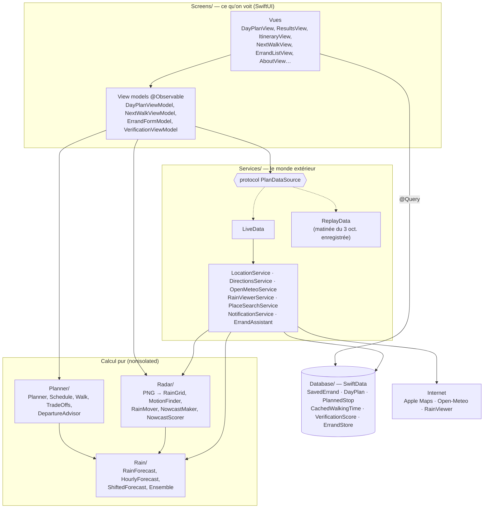

*"Everything is in one app target, sorted by what it does. Screens is what you see, Services talks to the outside world, Database is SwiftData, and three folders hold the pure logic: Planner, Rain and Radar. Those logic types never touch the screen, so they are nonisolated and the heavy work runs off the main thread."*

### Pourquoi plus de package ?

- Au début, le calcul était dans un package Swift pour le tester sous Linux (je n'ai le Mac du lab que le mercredi).
- Le calcul est fini et testé. Pour l'entretien, il est plus simple qu'une personne qui ouvre le projet trouve tout au même endroit : plus de modules, plus d'`import`, plus de `public`.
- Il reste deux traces de l'époque Linux :
  - `GeoPoint` à la place de `CLLocationCoordinate2D`, parce qu'il est `Codable` et `Hashable` ;
  - mon propre décodeur PNG, qui lit les couleurs exactes sans l'alpha prémultiplié de Core Graphics.

### Le protocole `RainForecast` : une seule « prise » pour la pluie

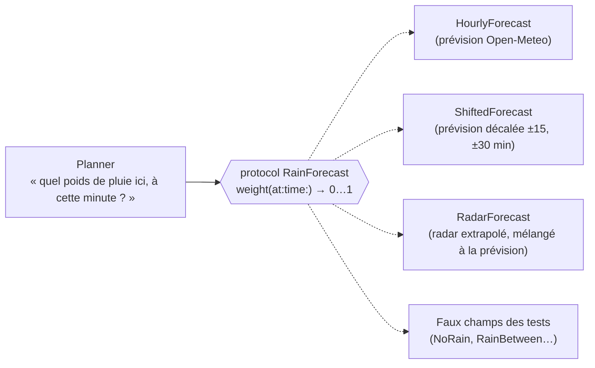

*"The planner doesn't know where the rain comes from. Anything that answers 'how much rain here at this minute' can be plugged in. That's how I added the nowcast without touching the planner."*

### Le protocole `PlanDataSource` : même idée pour le monde extérieur

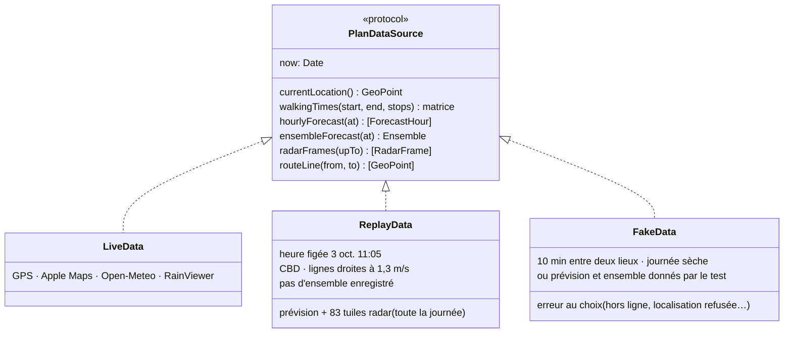

*"Replay mode is just another data source. The view models don't know if the data is live, recorded, or fake in a test."*

---

## 3. Les écrans et la navigation

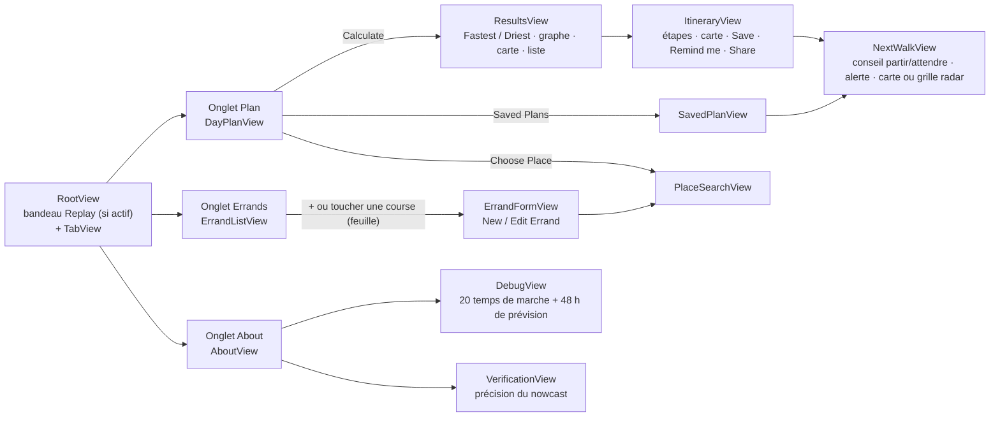

- `TabView` avec une `NavigationStack` par onglet (règle Apple, comme la semaine 6).
- Le formulaire s'ouvre en `.sheet` avec sa propre `NavigationStack`, comme dans les labs.

---

## 4. Le bouton « Calculate », pas à pas

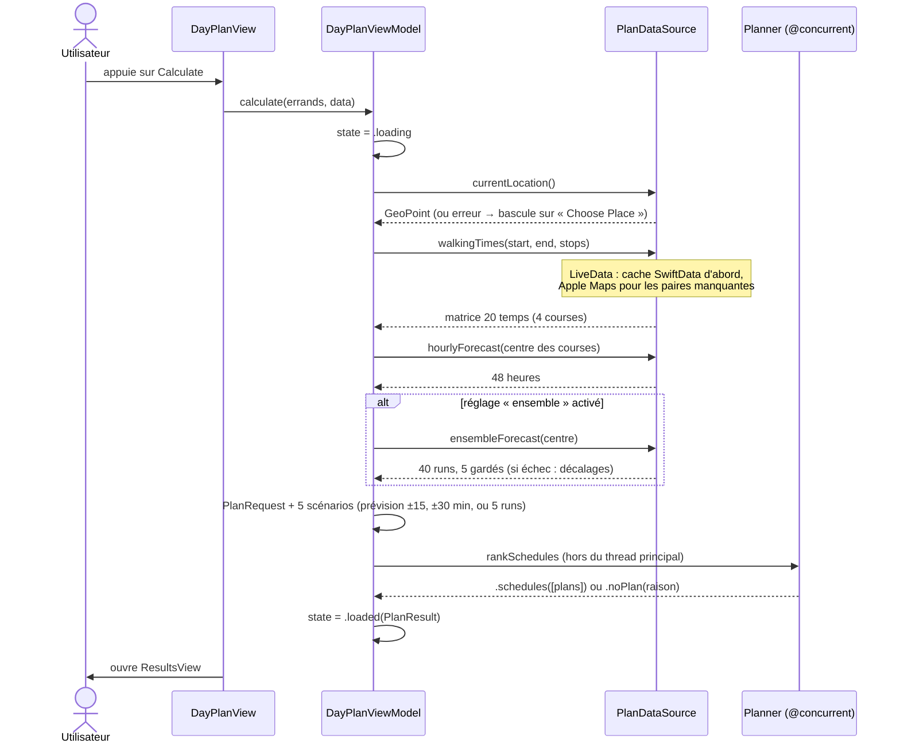

Fichier : `Screens/Plan/DayPlanViewModel.swift`, fonction `calculate`. Le texte de progression (« Getting walking times… ») vient de la propriété `progress`.

### `LoadState` : le feu tricolore de chaque écran

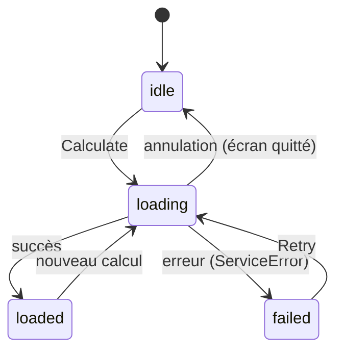

*"Every screen that loads data switches on one enum: idle, loading, loaded or failed. The view never guesses; it shows a spinner, the content, or an error with a Retry button."*

---

## 5. Le solveur (`Planner/`)

### L'algorithme en 6 temps

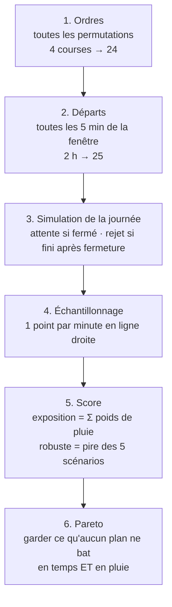

24 ordres × 25 départs × 5 scénarios = 3 000 évaluations : instantané. La fonction tourne quand même hors du thread principal (`@concurrent`), pour que l'écran reste fluide.

### La simulation d'une journée (`Planner.simulate`)

```text
Départ 14:00 ──10 min──▶ Poste (ouvre 09:00, ferme 17:00, tâche 10 min)
                          arrivée 14:10 · début 14:10 · fin 14:20
          ──5 min──▶ Bibliothèque (ouvre 14:30, tâche 20 min)
                          arrivée 14:25 · ATTENTE 5 min · début 14:30 · fin 14:50
          ──15 min──▶ Maison : retour 15:05

Début = max(arrivée, ouverture)      Rejet si fin > fermeture
```

C'est exactement le test `handComputedCaseB`.

### Les deux cas calculés à la main (tests `handComputedCaseA` et `handComputedCaseB`)

**Cas A.** Une averse de 14:00 à 14:30. La poste est à 10 min, la tâche dure 10 min : aller, tâche, retour = 30 min.

| Départ | Aller (min de pluie) | Retour (min de pluie) | Total | Retour à | Durée | Gardé ? |
| --- | --- | --- | --- | --- | --- | --- |
| 13:55 | 13:55–14:05 → 5 | 14:15–14:25 → 10 | 15 | 14:25 | 30 | oui |
| 14:00 | 10 | 14:20–14:30 → 10 | 20 | 14:30 | 35 | non |
| 14:05 | 10 | 14:25–14:35 → 5 | 15 | 14:35 | 40 | non |
| 14:10 | 10 | 14:30–14:40 → 0 | 10 | 14:40 | 45 | oui |
| 14:15 | 10 | 0 | 10 | 14:45 | 50 | non |
| 14:20 | 10 | 0 | 10 | 14:50 | 55 | non |
| 14:25 | 14:25–14:35 → 5 | 0 | 5 | 14:55 | 60 | oui |
| 14:30 | 0 | 0 | 0 | 15:00 | 65 | oui |

**Cas B.** Après-midi sec, départ à 14:00.

- Poste : à 10 min de la maison, tâche de 10 min.
- Bibliothèque : à 15 min de la maison, ouvre à 14:30, tâche de 20 min.
- Poste ↔ bibliothèque : 5 min.

Les deux ordres possibles :

- Poste d'abord : 14:10 poste → 14:20, 14:25 bibliothèque, attente 5 min, 14:30 → 14:50, maison à 15:05 (65 min).
- Bibliothèque d'abord : 14:15 bibliothèque, attente 15 min, 14:30 → 14:50, 14:55 poste → 15:05, maison à 15:15 (75 min).

Le solveur ne garde que « poste d'abord ».

### Le score

- Poids horaire (`ForecastHour.rainWeight`) : `w = probabilité/100 × min(1, précipitation en mm/h)`. Exemple : 60 % et 0,5 mm → 0,3. Raison : 1 mm/h suffit à mouiller un piéton.
- Exposition d'un trajet = somme des poids, minute par minute (`WalkRain`).
- Score robuste = **pire** des 5 scénarios (prévision telle quelle, 30 et 15 min plus tôt, 15 et 30 min plus tard).
- Avec le réglage *ensemble* : Open-Meteo fait tourner son modèle 40 fois depuis des départs un peu différents. `Ensemble.scenarios` classe les runs selon la pluie qu'ils donnent pendant ta fenêtre et garde ceux des 10e, 30e, 50e, 70e et 90e centiles. Chaque run devient un `HourlyForecast` (poids = `min(1, mm)`), donc le solveur ne change pas.

*"I take the worst case, not the average: like taking the earlier train so you're still on time if your bus is late. A robust plan stays good if the rain comes 15 minutes early or late."*

### Le front de Pareto (`TradeOffs`)

```text
 pluie (min, pire cas)
   │  ●                        ● = plan gardé (personne ne le bat sur les deux axes)
 3 │     ○                     ○ = plan dominé : un autre est plus rapide ET plus sec
   │        ●
 2 │           ○   ○
   │              ●
 1 │                    ●
   └──────────────────────── durée jusqu'au retour (min)
      50    55    60    65
```

- On trie par durée, puis on ne garde un plan plus lent que s'il est plus sec que tous les plus rapides.
- La durée est mesurée **depuis le début de la fenêtre**, sinon partir plus tard ne coûterait rien.

*"Like choosing a flight: you never buy one that is both more expensive and longer. What is left is the frontier, and the user chooses between fast and dry on the chart."*

### Quand rien ne marche

Le solveur compte combien de fois chaque course a fait échouer un plan. La plus fautive est donnée à l'utilisateur : « Post closes at 13:00, so it can't fit in this window » (`NoPlanReason.closesTooEarly`).

---

## 6. Le nowcast radar (`Radar/`) — le Wow Factor

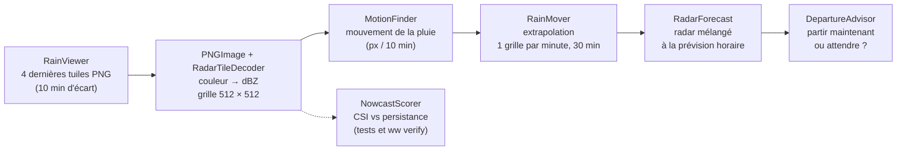

### 1. Lire l'image

- RainViewer encode la réflectivité radar (dBZ) en couleurs (palette « Universal Blue », fichier CSV publié par RainViewer).
- Mon décodeur PNG (`PNGImage`) lit les morceaux du fichier (`IHDR`, `IDAT`, `IEND`), décompresse avec `NSData.decompressed(using: .zlib)`, puis annule les filtres de ligne (None, Sub, Up, Average, Paeth). Ensuite, `RadarTileDecoder` transforme chaque couleur en dBZ avec `RadarColorTable`.
- Pourquoi pas `UIImage` : Core Graphics prémultiplie l'alpha, ce qui change les couleurs semi-transparentes de la palette. Je dois retrouver la couleur **exacte** pour lire la bonne valeur dans la table.
- Les tuiles du rejeu ont l'extension `.tile`, sinon Xcode les ré-encode en PNG « CgBI » d'Apple (bug trouvé grâce aux captures de la CI).

### 2. Où est Melbourne sur l'image ? (`PixelConverter`)

Mercator sphérique, comme MapKit : `X = (longitude + 180)/360 × 2^zoom × 512`. Le CBD tombe vers le pixel (278, 277) de la tuile zoom 7, x 115, y 78 (test `georeferencesMelbourneCBD`). 1 pixel ≈ 480 m.

### 3. Comment la pluie bouge (`MotionFinder`)

```text
  image à 10:50                        image à 11:00
  ┌────┬────┬────┐                     ┌────┬────┬────┐
  │    │ ▓▓ │    │   pour chaque bloc   │    │    │ ▓▓ │
  ├────┼────┼────┤   16 × 16 px avec    ├────┼────┼────┤
  │    │    │    │   de la pluie, on    │    │    │    │
  └────┴────┴────┘   essaie tous les    └────┴────┴────┘
                     décalages ±24 px ;
                     le plus ressemblant = le mouvement
```

- Ressemblance = somme des différences absolues ; recherche grossière tous les 3 px, puis fine au pixel.
- Ensuite, filtre médian 3 × 3 sur les vecteurs (supprime les vecteurs aberrants) et moyenne sur 3 paires d'images.
- Trop peu de blocs de pluie (moins de 5) : un seul vecteur global pour toute l'image.

*"Like two photos of a crowd taken ten minutes apart: for each small group in the first photo, I try every nearby shift in the second one; the best match is how far it moved."*

### 4. Prolonger le mouvement (`RainMover`, semi-lagrangien arrière)

`pluie(t0 + k, x) = pluie(t0, x − k/10 · v(x))` pour k = 1…30 minutes.

*"To know what will pass under a bridge in 10 minutes, look at what is floating 10 minutes upstream now."* Chaque case du futur va chercher sa valeur en amont, donc aucune case ne reste vide.

On ne calcule que la zone utile (le trajet + 73 px de marge, soit ~35 km, la distance que la pluie parcourt en 30 min), pas les 512 × 512 pixels.

### 5. Mélanger avec la prévision (`RadarForecast`)

```text
part du radar
  1 ┤●
    │  ●
0,5 ┤     ●
    │        ●
  0 ┤───────────●───────▶ minutes après la dernière image radar
    0     15    30
w = part × w_radar + (1 − part) × w_prévision
```

- Échéance mesurée depuis la **dernière image**, pas depuis « maintenant » : l'image a déjà quelques minutes de retard.
- Radar en mm/h par Marshall–Palmer : `Z = 200 R^1,6` (20 dBZ ≈ 0,65 mm/h ; 40 dBZ ≈ 11,5 mm/h).

### 6. Les cas où le radar ne sert pas (`NowcastMaker`)

| Cas | Ce que fait l'app |
| --- | --- |
| Dernière image de plus de 30 min | `.stale` : prévision horaire seule, message « too old to use » |
| Pas d'image (hors ligne, RainViewer en panne) | `.noFrames` : prévision horaire seule, message |
| Un lieu hors de la tuile de Melbourne | `.outsideRadar` : prévision horaire seule, message |

### 7. Est-ce que ça marche vraiment ? (`NowcastScorer`)

- On compare à la **persistance** (« la pluie ne bouge pas ») avec le CSI = touchés / (touchés + manqués + fausses alertes), seuil 20 dBZ.
- Sur le jour pluvieux enregistré du 3 octobre, autour du CBD : nowcast 0,314 contre persistance 0,291 à 20 min (0,425 contre 0,404 à 10 min). Le gain est réel mais modeste. Les jours sans pluie près du CBD donnent 0 partout. `./ww verify` rejoue chaque jour enregistré.
- **Dans l'app** (About ▸ *How Accurate Is the Nowcast?*) : `VerificationViewModel` fait le même calcul que `ww verify`, sur la même zone (96 px autour du pixel du CBD), avec les 83 images embarquées ou les 13 dernières images en direct. Il trouve les mêmes chiffres. Le calcul tourne dans une fonction `@concurrent`, une échéance à la fois (environ 30 s en debug), et chaque score devient un `VerificationScore` dans SwiftData, affiché en barres avec Swift Charts.

*"I verify against persistence, the naive 'rain doesn't move' forecast. On the rainy day I recorded, the nowcast beats it at 10, 20 and 30 minutes. The gain is modest, and I say it honestly: beyond 30 minutes I hand over to the hourly forecast."*

---

## 7. « Partir maintenant ou attendre ? » (écran Next Walk)

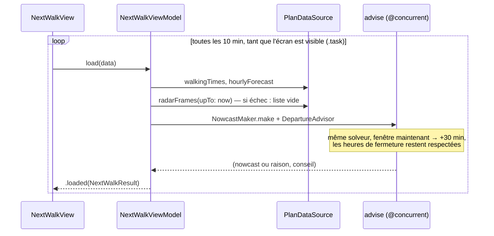

- `DepartureAdvisor` compare « partir maintenant » au plan le plus sec de la fenêtre. Il conseille d'attendre seulement si on gagne au moins 1 minute de pluie.
- La **collision view** (`CollisionView`) montre la pluie observée (curseur à gauche de 0) ou prévue (à droite, de plus en plus pâle), le trajet et ton point orange qui avance. Le curseur va de −30 à +30 min. Deux vues au choix :
  - **Map** (`RadarMapView`) : sur une ligne de pixels, les pixels voisins de même niveau de pluie forment une bande. Chaque bande devient un `MapPolygon` dont les coins sont convertis en latitude/longitude par `PixelConverter.point(forPixelX:y:)` (l'inverse de `pixel(for:)`). Ça donne quelques centaines de formes au lieu d'une par pixel.
  - **Radar Grid** (`Canvas`, le plan B du cahier) : un carré de couleur par pixel. Elle marche sans réseau.
- **Alerte pluie** : à chaque rafraîchissement (10 min), `rainAlert()` regarde si le trajet « partir maintenant » est pluvieux. Il n'envoie une notification que si ce n'était pas déjà le cas (`foundRain`), pour ne pas alerter toutes les 10 minutes. `NotificationService` est le délégué de `UNUserNotificationCenter` pour que la bannière s'affiche même app ouverte. Limite honnête : sans tâche de fond, l'alerte ne marche que quand l'écran est ouvert.

---

## 8. Les données (SwiftData)

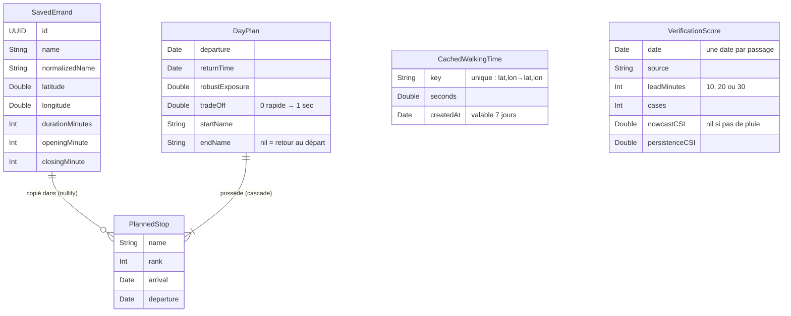

- **Supprimer un plan** supprime ses arrêts (`cascade`), test `deletingPlanDeletesItsStops`.
- **Supprimer une course** garde la copie dans les anciens plans (`nullify`) : l'historique ne change pas, test `deletingErrandKeepsThePlannedCopy`.
- Pas de `CLLocationCoordinate2D` dans SwiftData : deux `Double` et une propriété calculée `location`.
- Doublons : `normalizedName` (minuscules, sans accents ni espaces autour). « Café Coles » et « cafe coles » sont la même course.
- `ErrandStore.add` et `ErrandStore.update` renvoient un enum `SaveErrandResult` (`saved`, `duplicateName`, `failed`), comme `HeroStore` au lab 3. Le formulaire peut alors dire « You already have an errand called “Coles” ». En modification, `hasOtherErrand(named:than:)` ignore la course elle-même, pour qu'elle puisse garder son nom.
- `DayPlan.tradeOff` retient où se trouvait le plan enregistré sur le front (0 = le plus rapide, 1 = le plus sec). Après deux plans, `PlanResult.usualChoice` prend la moyenne et propose le plan le plus proche. La valeur par défaut (0,5) évite de casser les données déjà enregistrées.

---

## 9. Concurrence (Swift 6)

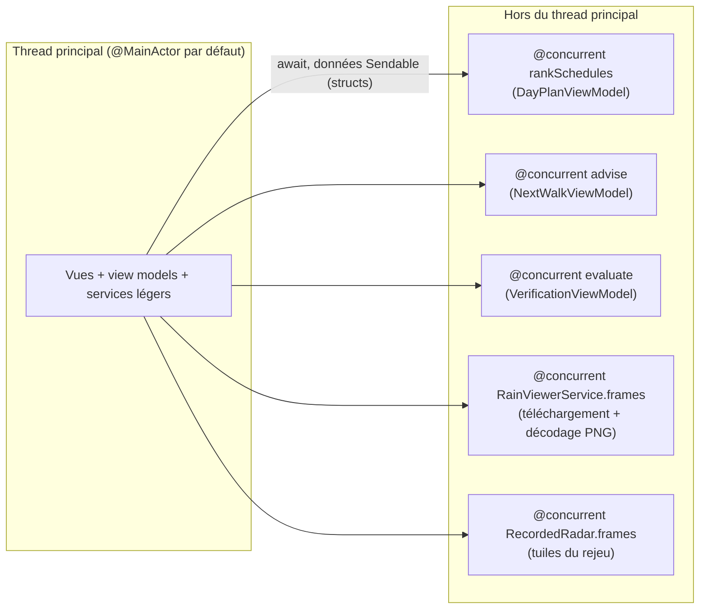

- Réglages Xcode 26 : *Default Actor Isolation = MainActor* et *Approachable Concurrency = Yes*.
- Les types de `Planner/`, `Rain/` et `Radar/` sont `nonisolated` : ils ne touchent pas l'écran, donc ils peuvent tourner ailleurs que sur le thread principal.
- `@concurrent` = « lance cette fonction en arrière-plan ». Sans ce mot, une fonction `async` tourne sur le thread de celui qui l'appelle (Approachable Concurrency).
- Ce qui traverse est `Sendable` : des `struct` (`PlanRequest`, `RadarFrame`…), jamais un objet `@Model`.

*"The waiter takes the orders, the kitchen cooks: the main thread runs the UI, the heavy work is sent off with @concurrent, and comes back with the result."*

---

## 10. Erreurs et cas inattendus

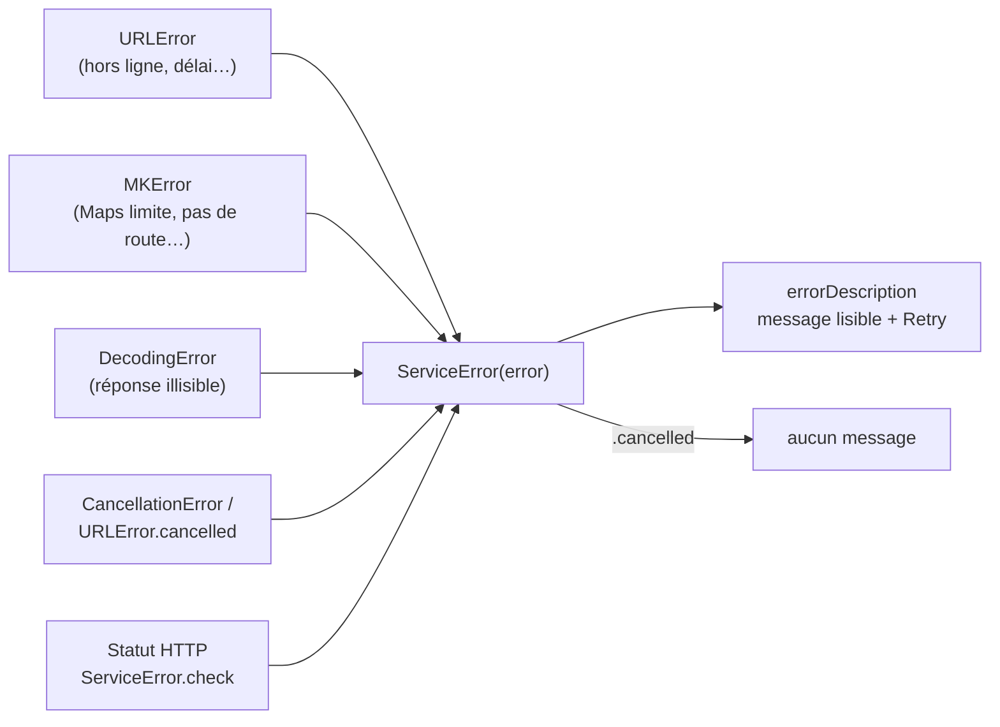

| Situation | Réponse de l'app |
| --- | --- |
| Hors ligne | « You're offline… » + Retry ; temps de marche lus dans le cache |
| Open-Meteo 5xx / 429 | « Weather service unavailable, try again in a minute. » / « Too many requests… » |
| Apple Maps limite | Une nouvelle tentative après 3 s, puis message |
| Localisation refusée | Message + bascule sur « Choose Place » |
| Notifications refusées | Bouton « Turn On Notifications in Settings » |
| Aucun plan possible | La raison : quelle course, quelle fermeture |
| Radar vieux / absent / hors zone | Prévision horaire seule + message |
| Ensemble indisponible (réseau, rejeu) | Repli sur la prévision décalée ; la note des résultats le dit |
| Apple Intelligence absent | La section « Describe It » n'apparaît pas |
| Base de données illisible | Le seul `fatalError`, comme le modèle d'Apple |

Le tableau complet, ligne par ligne avec ses tests, est dans `docs/error-table.md`.

---

## 11. Le mode rejeu (pour la démo)

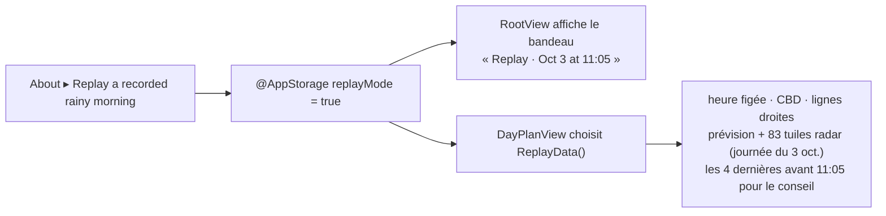

- La démo ne dépend ni de la météo du jour, ni du réseau du lab.
- Le bandeau (texte + couleur) est permanent pour qu'une pluie rejouée ne soit jamais prise pour la météo du jour.
- Les tests UI lancent l'app avec `--sample-data -replayMode YES`.

---

## 12. Fichier par fichier (30 secondes chacun)

Tous les chemins partent de `repo-mac-gitlab/WeatherWindow/`.

### `App/`

| Fichier | En une phrase | Détail à savoir |
| --- | --- | --- |
| `WeatherWindowApp` | Crée la base SwiftData, injecte `ErrandStore` et `NotificationService` | Sans base, l'app ne peut rien faire : seul `fatalError`, comme le modèle d'Apple. `--sample-data` = base en mémoire avec 4 courses |
| `RootView` | Les 3 onglets (une `NavigationStack` chacun), et le bandeau de rejeu au-dessus | |

### `Screens/Plan/`

| Fichier | En une phrase | Détail à savoir |
| --- | --- | --- |
| `DayPlanView` | Formulaire du jour : courses, départ, arrivée, fenêtre, bouton Calculate fixé en bas | Choisit `LiveData` ou `ReplayData` ; si l'app est restée ouverte, la fenêtre ne commence jamais dans le passé |
| `DayPlanViewModel` | `calculate` : position → temps de marche → prévision → solveur, chaque étape affichée dans `progress` | Jusqu'à 24 ordres × 49 départs × 5 scénarios : `@concurrent`. Sans ensemble, repli sur la prévision décalée. Le lieu de départ est retenu entre deux lancements |
| `DayPlanViewModel` → `PlanResult` | Tout ce qu'un calcul a produit, pour les écrans résultats, itinéraire et carte | `schedules` est trié par durée : le premier = le plus rapide, le dernier = le plus sec. `save` n'enregistre qu'une fois (`isSaved`). `tradeOff` : 0 rapide → 1 sec. `usualChoice` après 2 plans enregistrés |
| `ResultsView` | Cartes « Fastest », « Driest », « Your Usual Choice », graphe, carte, liste | |
| `TradeOffChart` | Swift Charts (lab 9) : temps contre pluie | La sélection revient à nil quand le doigt se lève : seul un vrai toucher change le plan choisi |
| `RouteMapView` | Le plan sur une carte : sec = plein et bleu, pluvieux = pointillé et orange | Une minute est pluvieuse si un des scénarios a de la pluie (poids ≥ 0,1). Ligne droite tant qu'Apple Maps n'a pas répondu |
| `ItineraryView` | Étapes, enregistrement, rappel, partage, accès au radar | L'id du plan sert d'id au rappel : redemander remplace l'ancien rappel |
| `SavedPlanView` | Un jour enregistré, relu tel quel depuis SwiftData ; « je suis ici » → conseil radar | |

### `Screens/NextWalk/`

| Fichier | En une phrase | Détail à savoir |
| --- | --- | --- |
| `NextWalkViewModel` | Re-planifie la suite de la journée depuis ici sur 30 min, avec le nowcast | Sans images radar, le conseil marche quand même avec la prévision horaire. `foundRain` : une seule alerte, pas une toutes les 10 min |
| `NextWalkView` | « Partir ou attendre ? », alerte pluie, carte ou grille, curseur de temps | La boucle `.task` recharge toutes les 10 min et s'arrête quand l'écran disparaît. Curseur −30 (radar observé) à +30 (extrapolé) |
| `DepartureAdviceCard` | « Leave now » ou « Wait 20 min », la pluie de chaque choix, bouton de rappel | |
| `CollisionView` | Pluie au temps du curseur, trajet, ta position ; carte Apple ou `Canvas` | La pluie prévue pâlit avec l'échéance. Gros plan d'environ 8 km. Crédit RainViewer en haut pour laisser visibles ceux d'Apple en bas |
| `RadarMapView` | Bandes de pixels de pluie en `MapPolygon` | Les pixels voisins de même niveau sur une ligne forment un rectangle : quelques centaines de formes au lieu d'une par pixel |
| `RainColor` | Niveau 0 (sec) à 5 (orage) → couleur, et des mots pour VoiceOver | |

### `Screens/Errands/` et `Screens/About/`

| Fichier | En une phrase | Détail à savoir |
| --- | --- | --- |
| `ErrandListView` | Bibliothèque : recherche, toucher pour modifier, glisser pour supprimer, + pour ajouter | |
| `ErrandFormView` + `ErrandFormModel` | Feuille nouveau/modifier ; Save reste désactivé tant qu'un champ est faux | Règles dans le modèle pour les tester. Nouvelle course : ouverte 9:00–17:00. `fill` ramène les valeurs d'Apple Intelligence dans les bornes du formulaire |
| `PlaceSearchView` | Suggestions en direct ; vide, hors ligne et erreur dans la liste, jamais en alerte | Retour clavier = recherche du texte tapé |
| `AboutView` | Identité, crédits, méthodes (DOI), labs, IA, réglages | |
| `VerificationView` + `VerificationViewModel` | « Le nowcast fait-il mieux que la persistance ? » sur de vraies images, scores dans SwiftData | Même zone que `ww verify` : 96 px (≈ 46 km) autour du pixel du CBD (278, 277). En direct : 13 images = les 2 h que garde RainViewer |
| `DebugView` | Preuve des 20 temps de marche, du cache et des 48 h | Chaque valeur Open-Meteo est la pluie de l'heure **qui se termine** à `time` |
| `Screens/Common/SharedViews` | `RainBadge`, `ForecastNotice`, `ErrorRow`, `ValidationMessage`, `PlaceLabel`, `ReplayBanner`… | Toujours une icône et des mots, jamais la couleur seule |

### `Database/`

| Fichier | En une phrase | Détail à savoir |
| --- | --- | --- |
| `SavedErrand` (+ `Place`) | Une course de la bibliothèque ; `makeStop()` en fait un `Stop` pour le solveur, avec le même id | `normalizedName` = minuscules sans accents, pour les doublons |
| `DayPlan`, `PlannedStop` | Un jour enregistré et la **copie** de ses arrêts | Modifier ou supprimer une course ne réécrit jamais l'historique. `endName == nil` = retour au départ |
| `CachedWalkingTime` | Un temps de marche Apple Maps gardé 7 jours | Clé unique `lat,lon→lat,lon` |
| `VerificationScore` | Un score CSI (nowcast et persistance) pour une échéance | CSI nil s'il n'y avait pas de pluie |
| `ErrandStore` | Ajoute, modifie, supprime ; renvoie `SaveErrandResult` comme `HeroStore` (lab 3) | En modification, la course elle-même est exclue du contrôle de doublon |
| `SampleData` (+ `LaunchOption`) | 4 vrais lieux du CBD pour les tests UI ; `--dark` force le mode sombre (le simulateur ignore le changement fait par un test UI) | |

### `Services/`

| Fichier | En une phrase | Détail à savoir |
| --- | --- | --- |
| `PlanDataSource` | Le protocole + `LiveData` (vrais services) + `ReplayData` (matinée enregistrée) | 4 images radar = 3 paires pour mesurer le mouvement. Rejeu : heure figée 11:05 (5 min après l'image de 11:00, comme en vrai), lignes droites à 1,3 m/s, pas d'ensemble |
| `OpenMeteoService` | URL, téléchargement et décodage (structs `OpenMeteoResponse`, `HourlyData`, `EnsembleResponse`) | `timeformat=unixtime` : aucune heure locale à lire. `forecastHours(from:)` est séparée du téléchargement pour tester toutes les réponses sans serveur |
| `RainViewerService` | Liste RainViewer + 4 tuiles décodées (`@concurrent`) | Palette 2 « Universal Blue », sans lissage ni neige |
| `DirectionsService` | Matrice des temps de marche avec cache, tracé réel pour la carte | Une requête à la fois (20 pour 4 courses). Apple Maps limite : on attend 3 s et on réessaie une fois. `paceFactor` 1,2 = 20 % plus lent |
| `LocationService` | Le `LocationProvider` du lab 7 en `async` (continuation) | « Unknown » = pas encore de position : on attend jusqu'au délai de 15 s |
| `PlaceSearchService` | `MKLocalSearchCompleter` autour de Melbourne, puis coordonnées | « Not found » = pas de suggestion, la liste le dit déjà |
| `NotificationService` | Permission demandée la première fois, rappel, alerte pluie | Délégué de `UNUserNotificationCenter` : sinon iOS cache les bannières app ouverte |
| `ErrandAssistant` | Foundation Models (iOS 26) : une phrase → `ErrandDraft` (`@Generable`) | Caché si Apple Intelligence n'est pas disponible |

### `Planner/` (le solveur)

| Fichier | En une phrase | Détail à savoir |
| --- | --- | --- |
| `Stop` (+ `Waypoint`) | Une course pour le solveur ; `Waypoint` = départ, arrivée ou une course | Heures en minutes depuis minuit, fuseau de Melbourne |
| `PlanRequest` | Tout ce dont le solveur a besoin, en valeurs simples (`Sendable`) | `departureTimes` : début de fenêtre puis tous les 5 min. `neededPairs` : 20 trajets pour 4 courses |
| `Planner` | Tous les ordres × tous les départs → simulation → score → `TradeOffs` | `simulate` : attente si fermé, rejet si la tâche finit après la fermeture. La course qui fait échouer le plus de plans est celle qu'on annonce |
| `Schedule` (+ `Visit`, `Walk`) | Un plan complet ; une visite (arrivée, attente, départ) ; un trajet et sa pluie par scénario | `robustExposure` = pire scénario. `duration` mesurée depuis le **début de la fenêtre** |
| `PlanOutcome` (+ `NoPlanReason`) | La réponse : les plans gardés, ou pourquoi rien ne marche | |
| `TradeOffs` | Le front de Pareto | Un plan plus lent n'est gardé que s'il est plus sec que tous les plus rapides |
| `WalkRain` (+ `WalkMinute`) | Un point par minute en ligne droite de A à B, puis Σ poids × minutes | Le point est au **milieu** de chaque minute |
| `DepartureAdvisor` | Partir maintenant ou attendre ? | Attendre seulement si on gagne au moins 1 min de pluie ; les fermetures restent respectées |

### `Rain/` (combien de pluie ici, à cette minute ?)

| Fichier | En une phrase | Détail à savoir |
| --- | --- | --- |
| `RainForecast` | Le protocole : `weight(at:time:)` → 0…1 | |
| `ForecastHour` | Une heure de prévision et son poids : probabilité × min(1 mm, pluie) | 1 mm/h suffit à mouiller un piéton |
| `HourlyForecast` | La prévision horaire, lue au centre des courses (la position est ignorée) | Open-Meteo donne à l'heure T la pluie de l'heure **avant** T : on cherche le premier T après l'instant voulu |
| `ShiftedForecast` | La même prévision décalée : telle quelle, 30 et 15 min plus tôt, 15 et 30 min plus tard | Décalage positif = la pluie arrive plus tard |
| `Ensemble` | Les 40 runs, et 5 runs choisis du plus sec au plus mouillé (centiles 50, 10, 30, 70, 90) | La médiane en premier = « la prévision telle quelle ». Un run pleut ou non : probabilité 100 % |

### `Radar/` (le nowcast)

| Fichier | En une phrase | Détail à savoir |
| --- | --- | --- |
| `PNGImage` | Lit un PNG RGBA 8 bits : morceaux, décompression, filtres de ligne | Octets « droits », pas prémultipliés |
| `RadarTileDecoder` | Tuile → `RainGrid` en dBZ, et part des couleurs inconnues | Couleur inconnue → couleur la plus proche, cherchée une seule fois par couleur |
| `RadarColorTable` | Couleur RainViewer → dBZ, depuis le CSV publié par RainViewer | Pixel transparent = `noEchoDBZ` (−32), le radar ne voit rien |
| `RainRate` | Marshall–Palmer `Z = 200 R^1,6` : dBZ → mm/h → poids | Seuil de pluie 20 dBZ ≈ 0,65 mm/h, partagé par tout le nowcast |
| `RainGrid` (+ `RadarFrame`, `PixelBox`) | Grille 512 × 512 de dBZ ; une image radar avec son heure ; un rectangle de pixels | `sample` lit entre les pixels (bilinéaire). Hors tuile = rien |
| `RadarTile` | La tuile zoom 7 (x 115, y 78, 512 px) qui contient Melbourne | |
| `PixelConverter` | Lieu → pixel (Mercator sphérique, comme MapKit), et pixel → lieu pour la carte | |
| `RainMotion` (+ `Movement`) | Un déplacement par bloc de 16 px, en pixels par 10 min | `movement(atX:y:)` mélange les 4 blocs les plus proches. `isGlobal` = un seul vecteur pour toute l'image |
| `MotionFinder` | Block matching : pour chaque bloc pluvieux, le décalage le plus ressemblant | ±24 px (≈ 70 km/h). Recherche grossière tous les 3 px puis fine. Égalité → le plus petit décalage. Médiane 3 × 3. Moins de 5 blocs → un vecteur global |
| `RainMover` | Prolonge la dernière image le long du mouvement, 1 image par minute | Semi-lagrangien arrière : chaque pixel futur va chercher sa valeur en amont, aucun trou |
| `NowcastMaker` (+ `Nowcast`, `NowcastOutcome`) | Images → mouvement → 30 min extrapolées autour du trajet | Image de plus de 30 min = `.stale`. Marge 73 px ≈ 35 km, la distance que la pluie parcourt en 30 min |
| `RadarForecast` | Le radar extrapolé comme `RainForecast`, fondu dans la prévision horaire | Part du radar : 1 à la dernière image, 0 à 30 min. L'échéance part de la **dernière image**, pas de « maintenant » |
| `NowcastScorer` | CSI = touchés / (touchés + manqués + fausses alertes), nowcast contre persistance | Ne compte que les images qui ont 3 paires avant elles |
| `RecordedRadar` | Les tuiles enregistrées, l'heure Unix dans le nom du fichier | Extension `.tile` pour qu'Xcode ne ré-encode pas le PNG |

### `Helpers/`

| Fichier | En une phrase |
| --- | --- |
| `GeoPoint` | Latitude/longitude, distance (haversine), centre de plusieurs points, conversion vers `CLLocationCoordinate2D` |
| `Melbourne` | Le fuseau horaire : heures d'ouverture et heures affichées en heure de Melbourne, les instants restent des `Date` |
| `PlanText` | Les phrases des écrans de plan. Moins d'une demi-minute de pluie = « Dry ». « Up to » parce que c'est le pire scénario |
| `ServiceError` | Toutes les erreurs (URLSession, MapKit, JSON, HTTP) ramenées à un enum avec un message lisible |
| `LoadState` | Le feu tricolore de chaque écran : idle, loading, loaded, failed |
| `RouteSplitter` | Coupe un tracé en morceaux secs et pluvieux pour la carte |

---

## 13. Ce que les tests prouvent

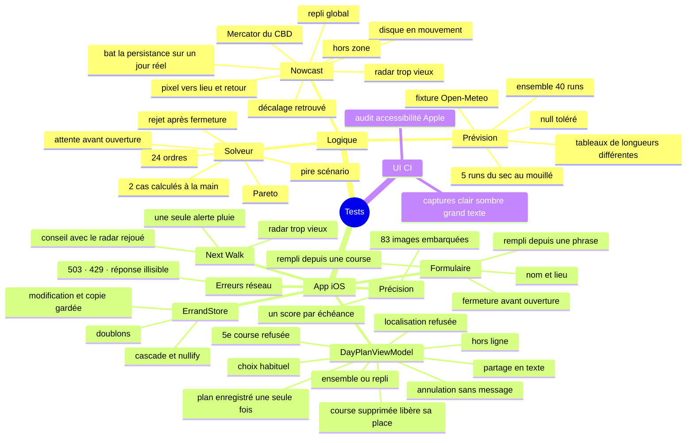

---

## 14. Les labs réutilisés

| Lab | Où il revient |
| --- | --- |
| Lab 3 : `List`, `Form`, navigation, `HeroStore` avec enum de résultat | Bibliothèque, formulaire, `ErrandStore` + `SaveErrandResult` |
| Lab 5 : `URLSession` + `Decodable`, view model `@Observable`, SwiftData | `OpenMeteoService`, view models, les 5 modèles, `id: UUID` comme `StoredBook` |
| Semaine 6 : `TabView`, erreurs `LocalizedError` | Les onglets, `ServiceError` |
| Lab 7 : MapKit, `LocationProvider` (`CLLocationManager`) | Carte, recherche de lieux, `LocationService` |
| Lab 9 : Swift Charts | Graphe temps contre pluie, barres de précision du nowcast |

---

## 15. Questions probables et réponses

**« Explain the purpose of your app. »**
*"WeatherWindow picks the order and the departure time of three or four walking errands so the walks between them stay as dry as possible, while respecting opening hours. Example: at 14:10 the forecast says '60 % rain this hour' — useless. The radar shows a band of rain moving toward my route; waiting 20 minutes gives a dry walk."*

**« Why is everything in one target? Why no package? »**
*"I started with a Swift package so I could test the solver and the nowcast on Linux, because I only have the Mac on Wednesdays. Once the logic was done and tested, I moved it into the app so the project is easier to read: one target, folders named after what they do. The logic folders, Planner, Rain and Radar, never touch the screen, so their types are nonisolated."*

**« Why straight lines in the solver, not the real Apple Maps routes? »**
*"A radar pixel is about 480 m. For a 1.5 km walk, the real path and the straight line are usually in the same pixel. It saves about 30 MapKit requests and keeps the solver testable without network. The real polyline is only used to draw the chosen plan."*

**« How do you inject dependencies / test without network? »**
*"One protocol, PlanDataSource, with a live implementation, a replay implementation and a fake one in the tests. The fake one can throw 'offline' or 'location denied' so I can test those cases."*

**« Why @Observable and not ObservableObject? »**
*"It's the current Apple pattern: the view only redraws for the properties it reads, and there's no @Published boilerplate. The view owns its view model with @State."*

**« How do you avoid freezing the UI? »**
*"The solver, the nowcast and the PNG decoding run in @concurrent functions. The logic types are nonisolated structs, so they are Sendable and can cross to the background safely."*

**« Why SwiftData? What happens when I delete an errand? »**
*"Saved plans copy the errand's values. Deleting an errand nullifies the link but keeps the copy, so history never changes. Deleting a plan cascades to its stops."*

**« What was the hardest part? »**
- RainViewer arrêté son nowcast le 1er janvier 2026 : j'ai donc écrit le mien.
- Le PNG ré-encodé par Xcode (CgBI) : trouvé grâce aux captures de la CI, réglé avec l'extension `.tile`.
- Le block matching dans une grande zone de pluie uniforme : tous les décalages se ressemblent, d'où le filtre médian et le repli global.
- Un seul jour de Mac par semaine : d'abord un package testé sous Linux, puis tout dans l'app, avec une CI GitHub qui compile et teste le vrai projet à chaque push.

**« Does the nowcast really work? »**
Voir la section 6.7 : oui sur le jour pluvieux enregistré, avec un gain modeste. Le dire honnêtement.

**« What does the ensemble setting change? »**
*"By default I shift one forecast 15 and 30 minutes earlier and later, which covers rain arriving early or late. With the ensemble, Open-Meteo runs its model 40 times from slightly different starts; I keep five runs from the driest to the wettest and score each plan on the worst. That covers whether it rains at all. The planner didn't change: both are lists of RainForecast."*

**« How does the app learn the user's preference? »**
*"Each saved plan remembers where it was on the frontier, 0 for the fastest and 1 for the driest. After two saved plans I average them and suggest the closest plan as 'Your Usual Choice'."*

**« Where do you use Apple Intelligence? »**
*"Only for one optional thing: describing an errand in a sentence. Foundation Models runs on the device and fills a @Generable struct; I clamp the values into the form's ranges and search the place in Apple Maps. If Apple Intelligence isn't available, the section is simply hidden."*

**« Did you use AI? »**
*"Yes, as stated on the About page. I used it to design and write parts of the code, then simplified everything so I can explain each file; I reviewed and ran all of it."*

---

## 16. Modifications en direct à répéter (cahier §15)

| Demande | Où changer | Attention |
| --- | --- | --- |
| Pas de départ 5 → 10 min | `Planner/PlanRequest.swift`, ligne 15 : `departureStep: TimeInterval = 10 * 60` | Changer aussi le texte « 5 minutes apart » dans `DayPlanView` |
| Seuil de pluie 20 → 25 dBZ | `Radar/RainRate.swift`, `rainThresholdDBZ` (ligne 11) | Relancer les tests (⌘U) ; `beatsPersistenceOnRecordedDay` peut changer |
| Ajouter une note à une course | `SavedErrand` : `var note = ""` · `ErrandFormModel` : `var note = ""` et le passer dans `makeErrand()` · `ErrandFormView` : un `TextField("Note", text: $model.note)` · `ErrandListView` : l'afficher dans `ErrandRow` | Une valeur par défaut évite de casser les données déjà enregistrées |
| 7 runs d'ensemble au lieu de 5 | `Rain/Ensemble.swift`, `scenarios(from:to:)` (ligne 26) : ajouter des centiles dans `[0.5, 0.1, 0.3, 0.7, 0.9]` | Le premier reste la médiane ; `picksFiveRunsFromDryToWet` attend 5 poids |
| Curseur à ±45 min | `Screens/NextWalk/NextWalkView.swift`, `TimeSlider` (ligne 118) : `in: -45...45` et les libellés | Le nowcast ne calcule que 30 min (`Radar/NowcastMaker.swift`, ligne 51, `minutes: 1...30`) : passer à `1...45`, sinon l'image reste celle de +30 |
