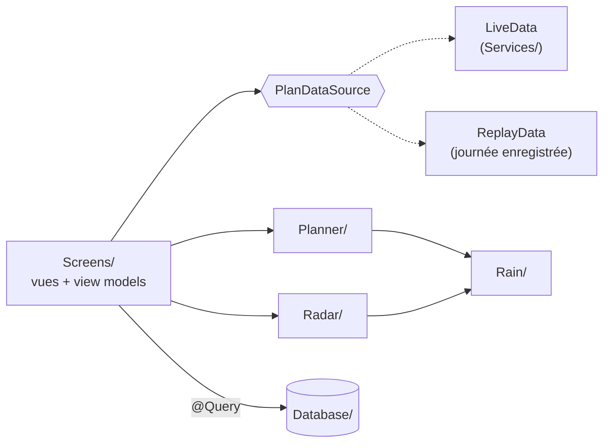
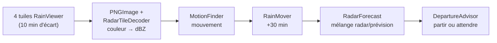

# WeatherWindow — comprendre le code

Tous les chemins partent de `repo-mac-gitlab/WeatherWindow/`. Les mots en **gras** sont les mots-clés à dire.

---

## 1. L'app en 30 secondes

- **But** : choisir l'**ordre** et l'**heure de départ** de 1 à 4 courses à pied pour rester **au sec**, en respectant les **heures d'ouverture**.
- **Données** : prévision horaire **Open-Meteo**, radar **RainViewer**, temps de marche **Apple Maps**.
- **3 onglets** : Plan, Errands, About.
- **Wow factor** : le **nowcast radar**. L'app mesure comment la pluie bouge et la prolonge **30 min** le long du trajet.

---

## 2. Les dossiers

```
App/        démarrage : WeatherWindowApp (base SwiftData), RootView (3 onglets)
Screens/    ce qu'on voit : un dossier par onglet, la vue et son view model côte à côte
Database/   ce qui est enregistré sur le téléphone (SwiftData)
Services/   ce qui parle au monde extérieur (Internet, GPS, Apple Maps, notifications)
Planner/    l'algorithme : quel ordre, quelle heure de départ
Rain/       « combien de pluie ici, à cette minute ? »
Radar/      le nowcast : images radar → pluie des 30 prochaines minutes
Helpers/    petits outils partagés (GeoPoint, Melbourne, ServiceError, LoadState…)
Resources/  la journée de pluie enregistrée (83 tuiles radar + prévision) et la table de couleurs
```



---

## 3. Le bouton Calculate, pas à pas

`Screens/Plan/DayPlanViewModel.swift`, fonction `calculate` :

1. **Position** : `data.currentLocation()`. Si elle est refusée, l'app bascule sur « Choose Place ».
2. **Temps de marche** : `data.walkingTimes(...)`, soit 20 trajets pour 4 courses. Le **cache** SwiftData sert d'abord, Apple Maps ensuite.
3. **Prévision** : `data.hourlyForecast(...)`, lue au **centre** des courses.
4. **5 scénarios** : la prévision ±15 et ±30 min (`ShiftedForecast`), ou 5 runs de l'**ensemble**.
5. **Solveur** : `Planner().rankSchedules(...)`, lancé en arrière-plan (**`@concurrent`**).
6. **Résultat** : `state = .loaded(PlanResult)`, puis l'écran `ResultsView` s'ouvre.

Chaque étape s'affiche dans `progress` (« Getting walking times… »).

---

## 4. Les idées clés

### `PlanDataSource` : d'où viennent les données (`Services/PlanDataSource.swift`)
- **Un protocole, trois versions** :
  - `LiveData` : les vrais services ;
  - `ReplayData` : la journée enregistrée ;
  - `FakeData` : les tests.
- Le view model **ne sait pas** d'où viennent les données. C'est ce qui rend les tests et la démo hors ligne possibles.

### `RainForecast` : une seule « prise » pour la pluie (`Rain/RainForecast.swift`)
- `weight(at:time:)` → un poids de pluie entre **0 et 1**.
- **Quatre sources** branchées sur la même prise :
  - `HourlyForecast` : la prévision ;
  - `ShiftedForecast` : la prévision décalée dans le temps ;
  - `RadarForecast` : le radar ;
  - les fausses pluies des tests.
- Le solveur **ne sait pas** d'où vient la pluie. C'est pour ça qu'ajouter le nowcast n'a rien changé au solveur.

### `LoadState` : le feu tricolore (`Helpers/LoadState.swift`)
- `idle` → `loading` → `loaded` ou `failed` (avec un bouton **Retry**).
- La vue fait un `switch` dessus et ne devine jamais l'état.

### Le solveur (`Planner/Planner.swift`)
- **Ordres** : toutes les permutations, soit **24** pour 4 courses (`orders`).
- **Départs** : toutes les **5 min** de la fenêtre (`PlanRequest.departureTimes`).
- **Simulation** (`simulate`) :
  - on **attend** si le lieu est encore fermé ;
  - on **rejette** le plan si la tâche finit après la fermeture.
- **Pluie d'un trajet** (`WalkRain`) : un point par **minute**, en **ligne droite**. On fait la somme poids × minutes.
- **Score robuste** = le **pire** des 5 scénarios (`Schedule.robustExposure`).
- **Front de Pareto** (`TradeOffs.best`) : on garde les plans qu'aucun autre ne bat à la fois en **temps** et en **pluie**.
- **Rien ne marche** : la course qui bloque le plus de plans est annoncée (`NoPlanReason.closesTooEarly`).
- Calcul : 24 ordres × 25 départs × 5 scénarios ≈ 3 000 simulations, donc instantané.

### Le poids de pluie (`Rain/`)
- Prévision : **probabilité × min(1 mm, pluie)**. Exemple : 60 % et 0,5 mm → 0,3.
- Open-Meteo donne à l'heure T la pluie de l'heure **avant** T (`HourlyForecast`).
- **Ensemble** (`Ensemble.scenarios`) : 40 runs, classés du plus sec au plus mouillé. On en garde 5 : centiles **50**, 10, 30, 70 et 90.
- Moins d'**une demi-minute** de pluie = « Dry » (`PlanText.isDry`).
- **Confiance 1, 2, 3** (`Schedule.confidence`) : l'écart entre le scénario le plus sec et le plus mouillé du plan. Moins de 2 min de pluie d'écart → **3**, moins de 5 min → **2**, sinon **1**. Affichée par `ConfidenceBadge`.

### Le nowcast radar (`Radar/`)



1. **Lire l'image** (`PNGImage`) : les morceaux du fichier (chunks), la **décompression zlib** (Foundation), puis les **filtres de ligne**. Pas `UIImage`, parce que l'**alpha prémultiplié** fausse les couleurs.
2. **Couleur → dBZ** (`RadarColorTable`), d'après la palette « **Universal Blue** » de RainViewer.
3. **Lieu → pixel** (`PixelConverter`) : projection **Mercator** comme MapKit. Le CBD est vers le pixel (278, 277). 1 pixel ≈ **480 m**.
4. **Mouvement** (`MotionFinder`) : le **block matching**.
   - Blocs de **16 px**, décalages jusqu'à **±24 px**.
   - Recherche grossière tous les 3 px, puis fine au pixel.
   - **Filtre médian** 3 × 3, et moyenne sur 3 paires d'images.
   - Moins de 5 blocs de pluie → un seul **vecteur global**.
5. **Prolonger** (`RainMover`) : advection **semi-lagrangienne arrière**. Chaque pixel futur va chercher sa valeur **en amont**, donc aucune case ne reste vide.
6. **Mélanger** (`RadarForecast`) : la part du radar va de **1 à 0 en 30 min**, et l'échéance est comptée depuis la **dernière image**. Pour passer du dBZ à la pluie : **Marshall–Palmer** Z = 200 R^1,6 (`RainRate`), avec un seuil de 20 dBZ ≈ 0,65 mm/h.
7. **Quand le radar ne sert pas** (`NowcastMaker`), l'app utilise la prévision horaire seule, avec un message :
   - `.stale` : image de plus de 30 min ;
   - `.noFrames` : aucune image ;
   - `.outsideRadar` : lieu hors de la tuile.
8. **Est-ce que ça marche ?** (`NowcastScorer`) : on compare au **CSI** de la **persistance** (« la pluie ne bouge pas »).
   - Le 3 octobre : **0,314 contre 0,291** à 20 min.
   - Le gain est **modeste** mais réel.

### L'écran Next Walk (`Screens/NextWalk/`)
- **Rechargement toutes les 10 min**, tant que l'écran est ouvert (boucle `.task`).
- **Partir ou attendre** (`DepartureAdvisor`) : on attend seulement si on gagne au moins **1 min** de pluie. Les fermetures restent respectées.
- **Collision view** : un curseur de −30 (radar **observé**) à +30 (radar **prévu**, de plus en plus pâle). Deux affichages :
  - sur la carte Apple : `RadarMapView`, des bandes de pixels en `MapPolygon` ;
  - en grille : `Canvas`, qui marche hors ligne.
- **Alerte pluie** : une seule notification, quand le prochain trajet devient pluvieux (`rainAlert`, `foundRain`).

### Les données (`Database/`)
- `SavedErrand` : une course de la bibliothèque. `DayPlan` + `PlannedStop` : un jour enregistré. `CachedWalkingTime` : un temps de marche gardé 7 jours. `VerificationScore` : un score de précision.
- **Supprimer un plan** supprime ses arrêts (**cascade**).
- **Supprimer une course** garde la copie dans les plans (**nullify**) : l'historique ne change jamais.
- **Doublons** : la comparaison se fait sur `normalizedName` (sans majuscules, accents ni espaces). `ErrandStore` renvoie `SaveErrandResult`, comme **HeroStore** au lab 3.
- Les coordonnées sont stockées comme **deux `Double`**, pas comme `CLLocationCoordinate2D`.

### La concurrence (Swift 6)
- Toute l'app est **`@MainActor` par défaut** (réglage Xcode 26).
- `Planner/`, `Rain/` et `Radar/` sont **`nonisolated`** : du calcul pur, qui ne touche pas l'écran.
- Le travail lourd est **`@concurrent`**, donc en arrière-plan : le solveur, le conseil radar, le score de précision et le décodage des PNG.
- Seules des **structs `Sendable`** passent d'un fil à l'autre, jamais un objet `@Model`.

### Les erreurs (`Helpers/ServiceError.swift`)
- `URLError`, `MKError`, `DecodingError` et les statuts HTTP sont tous ramenés à **un seul enum** `ServiceError`, avec un message lisible.
- Une **annulation** (l'utilisateur quitte l'écran) n'affiche aucun message.
- Une **erreur de localisation** (`isLocationError`) s'affiche juste sous le choix *Start* dans `DayPlanView`, les autres sous la fenêtre de départ.
- Le **seul `fatalError`** de l'app : la base de données illisible au lancement.

### Le mode replay (pour la démo)
- About ▸ *Replay a recorded rainy morning* : `ReplayData` remplace les vrais services.
- **Heure figée** au 3 octobre à 11:05, lignes droites à 1,3 m/s, 83 tuiles radar embarquées.
- **Hors ligne**, avec un **bandeau permanent** pour ne jamais confondre la pluie enregistrée avec la météo du jour.

---

## 5. Fichier par fichier

| Fichier | Rôle |
| --- | --- |
| **App/** | |
| `WeatherWindowApp` | Base SwiftData, injecte `ErrandStore` et `NotificationService` |
| `RootView` | 3 onglets + bandeau replay |
| **Screens/Plan/** | |
| `DayPlanView` | Choix des courses (« 2 of 3 » : max 4, ou moins s'il y a moins de courses), départ, arrivée, fenêtre, bouton Calculate |
| `DayPlanViewModel` | `calculate` ; `PlanResult` : enregistrer, partager, choix habituel |
| `ResultsView` | Plans Fastest / Driest / Usual, graphe, carte |
| `TradeOffChart` | Swift Charts temps contre pluie, toucher pour choisir |
| `RouteMapView` | Carte : sec en bleu plein, pluvieux en orange pointillé |
| `ItineraryView` | Étapes, Save, Remind me, Share, radar |
| `SavedPlanView` | Un jour enregistré, relu depuis SwiftData |
| **Screens/NextWalk/** | |
| `NextWalkView` / `NextWalkViewModel` | Conseil radar, rechargé toutes les 10 min, alerte |
| `DepartureAdviceCard` | « Leave now » ou « Wait 20 min » |
| `CollisionView` / `RadarMapView` | Pluie, trajet et ta position au temps du curseur |
| `RainColor` | dBZ → couleur et mots pour VoiceOver |
| **Screens/Errands/** | |
| `ErrandListView` | Liste, recherche, toucher pour modifier, glisser pour supprimer |
| `ErrandFormView` / `ErrandFormModel` | Formulaire, validation, « Describe It », section « Used in Plans » (via `plannedStops` → `plan`) |
| `PlaceSearchView` | Suggestions Apple Maps en direct |
| **Screens/About/** | |
| `AboutView` | Identité, crédits, méthodes, réglages |
| `VerificationView` / `VerificationViewModel` | Précision du nowcast, graphe, scores enregistrés |
| `DebugView` | Les 20 temps de marche et les 48 h de prévision |
| **Screens/Common/** `SharedViews` | `RainBadge`, `ConfidenceBadge`, `ErrorRow`, `ReplayBanner`… |
| **Database/** | Modèles SwiftData, `ErrandStore`, `SampleData` (4 courses de démo) |
| **Services/** | |
| `PlanDataSource` | Protocole + `LiveData` + `ReplayData` |
| `OpenMeteoService` | Prévision et ensemble : URL, téléchargement, JSON |
| `RainViewerService` | Liste des images radar + 4 tuiles décodées |
| `DirectionsService` | Temps de marche (cache 7 j, 1 nouvel essai après 3 s) et tracés |
| `LocationService` | Position, le `LocationProvider` du lab 7 en `async` |
| `PlaceSearchService` | `MKLocalSearchCompleter` autour de Melbourne |
| `NotificationService` | Permission, rappel de départ, alerte pluie |
| `ErrandAssistant` | Apple Intelligence : phrase → course (`@Generable`) |
| **Planner/** | |
| `Planner` | Ordres × départs → simulation → score → Pareto |
| `Schedule` | Un plan : `Visit` (arrivée, attente, départ), `Walk` (trajet + pluie) |
| `Stop` / `Waypoint` | Une course pour le solveur ; départ, arrivée ou course |
| `PlanRequest` | Toutes les entrées du solveur |
| `PlanOutcome` | Les plans gardés, ou `NoPlanReason` |
| `TradeOffs` | Front de Pareto |
| `WalkRain` | Un point par minute, somme de la pluie |
| `DepartureAdvisor` | Partir maintenant ou attendre |
| **Rain/** | `RainForecast` (protocole), `ForecastHour`, `HourlyForecast`, `ShiftedForecast`, `Ensemble` |
| **Radar/** | |
| `PNGImage`, `RadarTileDecoder`, `RadarColorTable` | PNG → couleurs → dBZ |
| `RainGrid` | Grille 512 × 512 ; `RadarFrame` (image + heure) ; `PixelBox` |
| `PixelConverter`, `RadarTile` | Lieu ↔ pixel, la tuile de Melbourne |
| `RainMotion`, `MotionFinder` | Mouvement de la pluie |
| `RainMover` | Extrapolation 30 min |
| `NowcastMaker`, `RadarForecast` | Assemble le nowcast, mélange avec la prévision |
| `RainRate` | dBZ → mm/h → poids |
| `NowcastScorer` | CSI contre persistance |
| `RecordedRadar` | Lit les tuiles enregistrées |
| **Helpers/** | `GeoPoint`, `Melbourne` (fuseau), `PlanText` (phrases), `ServiceError`, `LoadState`, `RouteSplitter` |

---

## 6. Les tests (⌘U)

- **Solveur** (`PlannerTests`) : attente avant l'ouverture, rejet après la fermeture, 24 ordres, pire scénario, Pareto, **2 cas calculés à la main**.
  - **Cas A** : averse de 14:00 à 14:30, poste à 10 min. On garde les départs 13:55, 14:10, 14:25 et 14:30, soit 15, 10, 5 et 0 min de pluie.
  - **Cas B** : poste puis bibliothèque (ouvre 14:30) → 5 min d'attente, retour à 15:05.
- **Prévision** (`ForecastTests`) : JSON réel, valeurs `null` tolérées, tableaux de longueurs différentes refusés, ensemble.
- **Radar** (`RadarTests`, `RadarTileDecoderTests`) :
  - Mercator du CBD ;
  - un décalage connu retrouvé ;
  - un disque qui bouge, bien prédit ;
  - le repli sur un vecteur global ;
  - **le nowcast bat la persistance** sur la journée réelle ;
  - radar trop vieux ou hors zone.
- **App** :
  - doublons, cascade et nullify (`ErrandStoreTests`) ;
  - validation du formulaire (`ErrandFormModelTests`) ;
  - mode hors ligne, localisation refusée, 5e course refusée, plan enregistré une seule fois (`DayPlanViewModelTests`) ;
  - 503, 429 et réponse illisible (`OpenMeteoServiceTests`) ;
  - une seule alerte pluie (`NextWalkTests`).
- **UI** : captures en clair, sombre et très grand texte, et **audit d'accessibilité Apple**.
- **Sans réseau** : `FakeData` remplace les services, et les tuiles du replay servent de radar.

---

## 7. Les labs réutilisés

| Lab | Dans WeatherWindow |
| --- | --- |
| Lab 3 : `List`, `Form`, navigation, `HeroStore` | Bibliothèque, formulaire, `ErrandStore` + `SaveErrandResult` |
| Lab 5 : `URLSession`, `Decodable` + `CodingKeys`, `@Observable`, SwiftData | `OpenMeteoService` (`OpenMeteoResponse`, `HourlyData`), view models, modèles |
| Semaine 6 : `TabView`, `LocalizedError` | Onglets, `ServiceError` |
| Lab 7 : MapKit, `LocationProvider` | Cartes, recherche de lieux, `LocationService` |
| Lab 9 : Swift Charts | Graphe temps contre pluie, graphe de précision |

---

## 8. Questions d'entretien → mots-clés

| Question | Mots-clés |
| --- | --- |
| *What does the app do?* | order + departure time · stay dry · opening hours · radar nowcast 30 min |
| *How is the code organised?* | one target · folders by role · Screens / Services / Database · logic in Planner, Rain, Radar |
| *Where does the data come from?* | `PlanDataSource` protocol · Live / Replay / Fake · view model doesn't know |
| *How does the solver work?* | all orders × departures every 5 min · simulate the day · worst of 5 scenarios · Pareto frontier |
| *Why the worst case?* | robust · rain 15–30 min early or late · like taking the earlier train |
| *What is the Pareto frontier?* | keep plans nobody beats on time AND rain · like choosing a flight |
| *Why straight lines?* | radar pixel ≈ 480 m · same pixel as the real path · no extra MapKit calls |
| *How does the nowcast work?* | PNG → dBZ · block matching · semi-Lagrangian advection · blend with forecast over 30 min |
| *Does it really work?* | CSI vs persistence · 0.314 vs 0.291 at 20 min · modest gain, said honestly |
| *Why your own PNG decoder?* | exact colours · premultiplied alpha in Core Graphics · zlib from Foundation |
| *How do you keep the UI smooth?* | MainActor by default · logic `nonisolated` · heavy work `@concurrent` · Sendable structs |
| *Why @Observable?* | current Apple pattern · redraws only what is read · no @Published · `@State` owns it |
| *What happens when I delete an errand?* | plans keep a copy · nullify · deleting a plan cascades |
| *How do you test without network?* | `FakeData` · throws offline / location denied · replay tiles as radar |
| *What if the radar is old or missing?* | stale / noFrames / outsideRadar · hourly forecast only + message |
| *What if something fails?* | one `ServiceError` enum · readable message + Retry · cancel = silent |
| *What does the ensemble change?* | 40 model runs · keep 5 from dry to wet · solver unchanged (`RainForecast`) |
| *How does it learn my preference?* | each saved plan: 0 fast → 1 dry · average after 2 plans · "Your Usual Choice" |
| *Where is Apple Intelligence?* | Foundation Models · sentence → `@Generable` errand · hidden if unavailable |
| *How does the demo work offline?* | replay mode · 3 Oct recorded · frozen clock · permanent banner |
| *Hardest part?* | RainViewer stopped its nowcast → wrote mine · Xcode re-encoded PNGs → `.tile` · uniform rain → median filter + global vector |
| *Did you use AI?* | yes, stated on About · design and parts of code · reviewed, run, simplified, explained |

---

## 9. Modifications en direct

| Demande | Où | Attention |
| --- | --- | --- |
| Départs toutes les 10 min | `Planner/PlanRequest.swift` l. 15 : `departureStep = 10 * 60` | Texte « 5 minutes apart » dans `DayPlanView` |
| Seuil de pluie 25 dBZ | `Radar/RainRate.swift` l. 11 : `rainThresholdDBZ` | ⌘U : `beatsPersistenceOnRecordedDay` peut changer |
| Une note sur une course | `SavedErrand` + `ErrandFormModel` : `var note = ""` ; un `TextField` dans `ErrandFormView` ; l'afficher dans `ErrandListView` | La valeur par défaut garde les données existantes |
| 7 runs d'ensemble | `Rain/Ensemble.swift` l. 26 : ajouter des centiles | La médiane reste en premier ; le test attend 5 |
| Curseur à ±45 min | `Screens/NextWalk/NextWalkView.swift` l. 118 : `in: -45...45` | `Radar/NowcastMaker.swift` l. 51 : `minutes: 1...45` |
